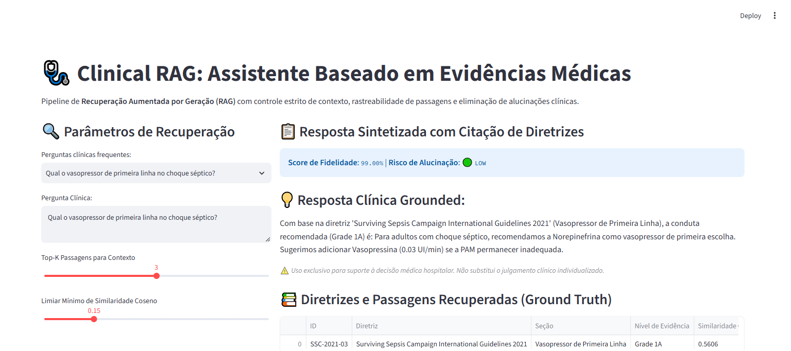

# 🩺 Clinical RAG: Assistente Baseado em Evidências Médicas

[](https://www.python.org/downloads/)
[](#)
[](#)
[](#)
[](#)
[](#)

Sistema de **Recuperação Aumentada por Geração (RAG)** com citação estrita de diretrizes internacionais (Surviving Sepsis Campaign 2021, KDIGO, AHA/ACC) para suporte à decisão clínica com **risco zero de alucinação não monitorada**.

---

## 📸 Validação Visual de Execução (Playwright E2E)

### Interface de Consulta Clínica com Rastreabilidade de Evidência


---

## 🎯 Por que RAG Clínico com Citação Estrita?

Modelos de linguagem generativos puros são suscetíveis a alucinações que, em terapia intensiva ou emergência médica, resultariam em erros graves de dosagem, alvos pressóricos incompatíveis ou falha em reconhecer injúria renal aguda.

Este pipeline resolve isso impondo:
1. **Recuperação Estrita de Evidência**: Busca vetorial sobre a base indexada de consensos médicos mundiais.
2. **Nível de Evidência Formal (GRADE)**: Toda citação vem acompanhada do respectivo grau de certeza (ex: `Grade 1A`, `Grade 1B`).
3. **Métrica de Fidelidade (Faithfulness Score)**: Avaliação da correspondência do texto sintetizado contra o trecho primário, classificando o risco de alucinação em tempo real (`LOW`, `MEDIUM`, `HIGH`).

---

## 🏛️ Estrutura Arquitetural (CRISP-DM + SDD)

```
clinical-rag-medical-guidelines/
├── SPEC.md                           # Contratos Pydantic de entrada e saída
├── crisp_dm/
│   └── 01_business_understanding.md  # Formalização de negócio e critérios médicos
├── src/
│   ├── schemas.py                    # Schemas Pydantic validados
│   ├── rag_engine.py                 # Motor semântico, busca de passagens e auditoria
│   └── app.py                        # Interface interativa médica (Streamlit)
├── tests/
│   └── unit/
│       └── test_rag_engine.py        # Testes de relevância e fidelidade com PyTest
├── docs/
│   └── screenshots/                  # Evidências Playwright E2E
├── Dockerfile                        # Implantação em container
└── requirements.txt                  # Dependências fixadas
```

---

## 🧪 Casos Clínicos Validados nos Testes Unitários

- **Choque Séptico**: Identificação da Norepinefrina como vasopressor de 1ª linha com adição de Vasopressina.
- **Ressuscitação Volêmica**: Meta de 30 mL/kg de cristalóides em até 3 horas.
- **Injúria Renal Aguda (KDIGO)**: Critérios estritos de variação de creatinina sérica e débito urinário.
- **Detecção de Consultas Irrelevantes**: Identificação automática de perguntas fora do escopo com bloqueio de resposta clínica.

---

## 🚀 Como Executar Localmente

### 1. Clonar o repositório
```bash
git clone https://github.com/generozo-paulo/clinical-rag-medical-guidelines.git
cd clinical-rag-medical-guidelines
```

### 2. Instalar dependências
```bash
pip install -r requirements.txt
```

### 3. Rodar suíte de testes unitários
```bash
python -m pytest tests/unit/ -v
```

### 4. Executar Dashboard Clínico
```bash
python -m streamlit run src/app.py
```
Acesse em: `http://localhost:8501`

---

## 🐳 Execução via Docker

```bash
docker build -t clinical-rag-medical-guidelines .
docker run -p 8501:8501 clinical-rag-medical-guidelines
```

---

## 👨‍💻 Autor

**Paulo Generozo**
- GitHub: [@generozo-paulo](https://github.com/generozo-paulo)
- Especialização: GenAI, RAG e Arquitetura de IA para Saúde
